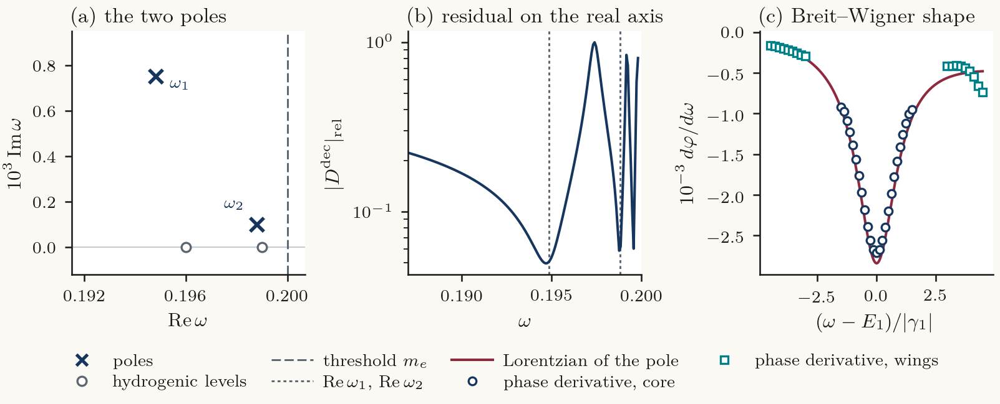

<!-- Author: Dr. Denys Dutykh (Mathematics Department, Khalifa University of Science and Technology, Abu Dhabi, UAE) -->

# kerr-dirac-scattering: two-channel Dollard scattering and partial-wave resonances for massive Dirac fields on Kerr



The two quasi-bound levels of the Schwarzschild benchmark (M = 1, electron mass mₑ = 0.2, λ = 1), computed by `quasibound_search.py` and stored in `results/quasibound_search.json`. Panel (a) shows the two poles ω₁ ≈ 0.1948345 + 7.51 × 10⁻⁴ i and ω₂ ≈ 0.1988022 + 9.97 × 10⁻⁵ i just below the mass threshold, beside the hydrogenic estimates mₑ(1 − (Mmₑ)²/(2n²)) for n = 1, 2. Panel (b) shows the relative Evans residual along the real frequency axis, whose dips sit at the real parts of the two poles. Panel (c) shows the derivative of the phase of the horizon reflection coefficient across the first level, measured on a grid of real frequencies, against the Lorentzian that the pole ω₁ predicts with no free parameter (plus an affine background fitted on the wings): the two agree to 6.4 per cent in relative L² norm on the core of the resonance. The panels are those of the last figure of the article, drawn here from the same data.

These Python codes accompany the article by Davide Batic and Denys Dutykh, "Two-Channel Dollard Scattering and Partial-Wave Resonances for Massive Dirac Fields on Kerr", which has been submitted. The article builds a two-channel scattering theory for massive Dirac fields outside a non-extreme Kerr black hole, with the horizon channel and the Dollard-modified channel at spatial infinity, and reduces the scattering operator, after separation of variables, to finite partial scattering matrices whose entries are ratios of conserved Wronskians. The codes compute these matrices by matching Jost solutions of the radial system, check unitarity, the conservation of the Wronskian and the identities that the conjugation symmetry implies, follow the convergence in the outer endpoint, and locate the quasi-bound levels in the mass gap together with their Breit–Wigner signature. Every table and figure of the article comes from them.

## The problem

After separation of variables in the Chandrasekhar–Page form, each partial wave obeys a first-order 2 × 2 radial system in the tortoise variable u,

```text
∂ᵤ R = A(u, ω) R,
```

whose solutions are fixed by Jost data at both ends: plane waves at the horizon (u → −∞), and at spatial infinity (u → +∞) Dollard-normalised columns corrected by the first transport terms, or, in the mass gap ω < mₑ, decaying columns with their Coulomb power. The partial scattering matrix is the finite matching

```text
S = (F_out)⁻¹ F_in,
```

and the conjugation symmetry of the system gives exact identities that every run checks, among them det F_in = −conj(det F_out). In the mass gap the channel at infinity is closed, and the partial scattering matrix reduces to a reflection coefficient S_HH at the horizon of modulus one; its quasi-bound poles are the zeros of the Evans denominator, and each one imprints a Breit–Wigner signature, with no free parameter, on the phase of S_HH along the real axis.

## Quick start

```bash
python3 -m pip install -r requirements.txt
make              # benchmarks and all figures (about 15 minutes on a laptop)
make benchmarks   # recompute results/ only (about 12 minutes)
make figures      # compile the TikZ diagrams and draw the data figures (about a minute)
make test         # quick check: the flat limit and the mass gap (a few seconds)
make clean        # remove auxiliary files (never touches results/)
```

The reference outputs are stored in `results/`; after `make benchmarks`, `git diff results/` is the reproduction check, and the differences should affect at most the last digit quoted in the article. With NumPy 2.5 and SciPy 1.18, `make test` reproduces the stored values to rounding and to the tolerance of the integrator: the moduli |S_HH| differ from one by at most 1.3 × 10⁻¹⁵ (2.2 × 10⁻¹⁶ in the stored files), and the phases of S_HH move by at most 6 × 10⁻¹⁰. The command `make figures` reads the JSON files of `results/`, so on a fresh copy it comes after `make benchmarks` (or a plain `make`).

All figures, the compiled TikZ diagrams as well as the Matplotlib plots, are written to `../latex/figures/`, that is outside this repository, into the folder of the manuscript that is expected to sit beside it (`FIGDIR` in the `Makefile`, `FIG_DIR` in `ku_style.py`); the folder is created when needed, and only `results/` is versioned here.

The two matching scripts accept options:

```bash
python3 schwarzschild_dirac_matching.py --refined        # start data with the refined phase Φ⋆
python3 kerr_dirac_matching.py --u-rights 80,120,180     # list of outer endpoints u₊
python3 kerr_dirac_matching.py --outdir results          # output folder
```

The runs with `--refined` write the files `*_refined_*` of `results/`. The count of the quasi-bound levels by the argument principle is not part of the `Makefile` and is run on its own, with `python3 quasibound_argument_principle.py`, in about ten seconds; it rewrites `results/quasibound_argument_principle.json`, whose zero counts it reproduces exactly.

## Contents

| Script | Computes |
| --- | --- |
| `dirac_radial_common.py` | the common machinery: tortoise maps (Lambert W for Schwarzschild, Brent inversion for Kerr), the radial matrix A(u, ω), the diagonaliser at infinity and the transport coefficients, the Dollard phase Φ and the refined phase Φ⋆, the Chandrasekhar–Page angular shooting, the finite matching S = (F_out)⁻¹ F_in with its conjugation identities, and the JSON and CSV writers |
| `schwarzschild_dirac_matching.py` | the Schwarzschild benchmark table of the article (unitarity defect, Wronskian, dependence on the matching point) |
| `kerr_dirac_matching.py` | the rotating benchmark table, with the angular eigenvalue λ₀₊ = 1.1609940906 |
| `convergence_study.py` | the two-tier convergence data: invariants converging like u₊⁻², channel phases like u₊⁻¹ log u₊ |
| `massgap_reflection.py` | the unimodularity of S_HH in the mass gap, for both geometries |
| `flat_limit_check.py` | the exact flat case M = 0 and the oblate flat case a = 0.4 |
| `quasibound_search.py` | the two quasi-bound levels ω₁ and ω₂ of the Schwarzschild benchmark and the data of their Breit–Wigner signature |
| `quasibound_argument_principle.py` | the winding number of the Evans determinant on three rectangles of the complex plane: one zero in each box around ω₁ and ω₂, two in the window that contains both, at two settings of the outer endpoint and of the tolerances and at two resolutions of the contour |
| `make_fig06.py` | the panels (b) and (c) of the sixth figure, on convergence and on the floor set by the tolerances, `fig06b-convergence.pdf` |
| `make_fig07.py` | the seventh figure, `fig07-quasibound.pdf`, drawn only when the quasi-bound levels have passed their three tests |
| `ku_style.py` | the style of the Matplotlib figures of the article |
| `figsrc/` | the TikZ sources of the diagrams (the first five figures and the panel (a) of the sixth), with the shared `figstyle.tex` |
| `results/` | the reference outputs, in JSON and CSV |
| `docs/figures/` | the figure of this page: `plot_readme_figure.py` draws it from `results/quasibound_search.json` with the style file beside it |

The benchmark parameters are the following, in units where the mass M is one.

| | Schwarzschild | Kerr |
| --- | --- | --- |
| M, a | 1.0, 0 | 1.0, 0.4 |
| electron mass mₑ, frequency ω | 0.2, 0.5 | 0.2, 0.5 |
| angular data | λ = 1 | k = 0, so that λ₀₊ = 1.1609940906 |
| u₋, u_match | −80, 20 | −40, 20 |
| relative and absolute tolerances of the radial integration | 10⁻¹⁰, 10⁻¹¹ | 10⁻¹⁰, 10⁻¹¹ |

The files of `results/` hold the following.

| File | Contents |
| --- | --- |
| `{schwarzschild,kerr}_dirac_matching[_refined]_output.json` | the complete benchmark records: parameters, geometric and angular data, and for each outer endpoint u₊ the complex scattering matrix (as pairs re, im), the unitarity defect, the variation of the Wronskian and of the matching point, the oriented fluxes, and the defects of the conjugation, reciprocity and transmission identities |
| `*_summary.csv` | the corresponding tables of the article |
| `convergence_study.json`, `.csv` | the unitarity defect and the drift of the transmission phase for u₊ from 60 to 360 (reference u_ref = 480), with the first-order and the refined phase |
| `massgap_reflection.json`, `.csv` | S_HH, its modulus minus one and its argument at ω = 0.05, 0.10, 0.15 and 0.18, for both geometries |
| `flat_limit_check.json` | the two flat cases, with the defects of antidiagonality, of the transmission modulus and of conjugation |
| `quasibound_search.json`, `quasibound_scan.csv` | the scan along the real axis, the two roots, their stability under refinement, the data of the Breit–Wigner signature, and the outcome of the three tests (field `gate`) |
| `quasibound_argument_principle.json` | the zero counts of the argument principle, contour by contour |

## The numerical method

All radial integrations use `scipy.integrate.solve_ivp` with the eighth-order Dormand–Prince method (DOP853) on the system ∂ᵤR = A(u)R, started from Jost data at both ends: plane waves at the horizon at u₋, and at u₊ the Dollard-normalised columns with their transport corrections, or in the mass gap the decaying columns with the Coulomb power (u/ℓ∞)^α̃. Every run monitors unitarity, the conservation of the Wronskian, the independence of the matching point, and the conjugation identity det F_in = −conj(det F_out). The angular eigenvalue of Kerr comes from a two-sided Chandrasekhar–Page shooting with an adaptive bracket, also integrated with DOP853.

A quasi-bound level is accepted only when three tests pass: the relative Evans residual at the root is below 10⁻¹⁰; the root moves by less than 5 per cent of |γₙ| when the outer endpoint and the tolerances are refined; and the Breit–Wigner overlay, with no free parameter, deviates by less than 10 per cent in relative L² norm on the core of the resonance. The script `make_fig07.py` draws no figure unless all three hold. The argument principle then confirms the count of zeros: the winding number of the Evans determinant is one on each box around ω₁ and ω₂ and two on the window containing both, the same at both settings and both contour resolutions, with the determinant bounded away from zero on every contour.

## Requirements

Python 3.12 or later with NumPy 1.26, SciPy 1.13 and Matplotlib 3.9 or later versions (`requirements.txt`), and, for the diagrams, a TeX Live installation with pdflatex, TikZ and the `standalone` class. The figure of this page needs NumPy and Matplotlib, and sets its labels with LaTeX when a TeX installation is present.

## How to cite

The article that these codes accompany, D. Batic and D. Dutykh, Two-Channel Dollard Scattering and Partial-Wave Resonances for Massive Dirac Fields on Kerr, has been submitted and has no public record yet. Until it is published, please cite the software:

```text
D. Batic and D. Dutykh, kerr-dirac-scattering: two-channel Dollard scattering and partial-wave
resonances for massive Dirac fields on Kerr, software, version 1.0.0 (2026).
```

https://github.com/dutykh/kerr-dirac-scattering

The button "Cite this repository" in the right-hand column of this page gives the same reference, read from `CITATION.cff`.

## Licence

GNU Lesser General Public License, version 2.1 (see `LICENSE`). Copyright © 2026 Davide Batic and Denys Dutykh.

## Authors

Davide Batic (davide.batic@ku.ac.ae) and Denys Dutykh (denys.dutykh@ku.ac.ae), Mathematics Department, Khalifa University of Science and Technology, PO Box 127788, Abu Dhabi, United Arab Emirates.

https://www.denys-dutykh.com/
